  <a href="https://prashon.com.np">
    <picture>
      <source media="(prefers-color-scheme: dark)" srcset="./assets/hero-dark.svg" />
      <source media="(prefers-color-scheme: light)" srcset="./assets/hero-light.svg" />
      
    </picture>
  </a>

  <a href="https://prashon.com.np"><strong>prashon.com.np</strong> ↗</a> &nbsp;&nbsp;·&nbsp;&nbsp;
  <a href="https://linkedin.com/in/mrprashon">LinkedIn ↗</a> &nbsp;&nbsp;·&nbsp;&nbsp;
  <a href="https://x.com/praashon">X ↗</a> &nbsp;&nbsp;·&nbsp;&nbsp;
  <a href="https://orcid.org/0009-0003-5372-9807">ORCID ↗</a> &nbsp;&nbsp;·&nbsp;&nbsp;
  <a href="mailto:prashon.social@gmail.com">prashon.social@gmail.com</a>

 

<code>02 / SELECTED WORK</code>

  <a href="https://github.com/Praashon/phalanx"><picture><source media="(prefers-color-scheme: dark)" srcset="./assets/work-01-dark.svg" /><source media="(prefers-color-scheme: light)" srcset="./assets/work-01-light.svg" /></picture></a>
  <a href="https://github.com/Praashon/seedatlas"><picture><source media="(prefers-color-scheme: dark)" srcset="./assets/work-02-dark.svg" /><source media="(prefers-color-scheme: light)" srcset="./assets/work-02-light.svg" /></picture></a>

  <a href="https://github.com/Praashon/adb-install-script-v2"><picture><source media="(prefers-color-scheme: dark)" srcset="./assets/work-03-dark.svg" /><source media="(prefers-color-scheme: light)" srcset="./assets/work-03-light.svg" /></picture></a>
  <a href="https://github.com/Praashon/Daydraft"><picture><source media="(prefers-color-scheme: dark)" srcset="./assets/work-04-dark.svg" /><source media="(prefers-color-scheme: light)" srcset="./assets/work-04-light.svg" /></picture></a>

  <a href="https://github.com/Praashon/vantage-preview"><picture><source media="(prefers-color-scheme: dark)" srcset="./assets/work-05-dark.svg" /><source media="(prefers-color-scheme: light)" srcset="./assets/work-05-light.svg" /></picture></a>
  <a href="https://github.com/Praashon/RouterChat"><picture><source media="(prefers-color-scheme: dark)" srcset="./assets/work-06-dark.svg" /><source media="(prefers-color-scheme: light)" srcset="./assets/work-06-light.svg" /></picture></a>

  Also shipped —
  <a href="https://github.com/Praashon/APK_Downloader">APK Grab</a> (4★) ·
  <a href="https://github.com/Praashon/usage-tracker">Usage Tracker</a> ·
  <a href="https://github.com/Praashon/planora">Planora</a> ·
  <a href="https://github.com/Praashon/Facebook-Unsaver-Script">FB Unsaver</a> ·
  <a href="https://github.com/Praashon/document-expiry-tracker">DocTracker</a> ·
  <a href="https://github.com/Praashon/any-vid-downloader">AnyVid</a>

  

  <picture>
    <source media="(prefers-color-scheme: dark)" srcset="./assets/overview-dark.svg" />
    <source media="(prefers-color-scheme: light)" srcset="./assets/overview-light.svg" />
    
  </picture>

