  <a href="https://prashon.com.np">
    <picture>
      <source media="(prefers-color-scheme: dark)" srcset="./assets/masthead-dark.svg" />
      <source media="(prefers-color-scheme: light)" srcset="./assets/masthead-light.svg" />
      
    </picture>
  </a>

  <a href="https://prashon.com.np"><picture><source media="(prefers-color-scheme: dark)" srcset="./assets/btn-portfolio-dark.svg" /><source media="(prefers-color-scheme: light)" srcset="./assets/btn-portfolio-light.svg" /></picture></a>&nbsp;
  <a href="https://linkedin.com/in/mrprashon"><picture><source media="(prefers-color-scheme: dark)" srcset="./assets/btn-linkedin-dark.svg" /><source media="(prefers-color-scheme: light)" srcset="./assets/btn-linkedin-light.svg" /></picture></a>&nbsp;
  <a href="https://x.com/praashon"><picture><source media="(prefers-color-scheme: dark)" srcset="./assets/btn-x-dark.svg" /><source media="(prefers-color-scheme: light)" srcset="./assets/btn-x-light.svg" /></picture></a>&nbsp;
  <a href="mailto:prashon.social@gmail.com"><picture><source media="(prefers-color-scheme: dark)" srcset="./assets/btn-email-dark.svg" /><source media="(prefers-color-scheme: light)" srcset="./assets/btn-email-light.svg" /></picture></a>&nbsp;
  <a href="https://orcid.org/0009-0003-5372-9807"><picture><source media="(prefers-color-scheme: dark)" srcset="./assets/btn-orcid-dark.svg" /><source media="(prefers-color-scheme: light)" srcset="./assets/btn-orcid-light.svg" /></picture></a>

 

  <picture>
    <source media="(prefers-color-scheme: dark)" srcset="./assets/spec-dark.svg" />
    <source media="(prefers-color-scheme: light)" srcset="./assets/spec-light.svg" />
    
  </picture>

  
<code>04 / INDEX</code> &nbsp;—&nbsp; Engineering principles &amp; unpinned archive

   
  <table>
    <tr>
      <td valign="top" width="50%">
        <strong>Principles</strong>  
        <code>01</code> Deterministic &amp; verifiable before clever. 
        <code>02</code> Local-first tooling with minimal surface area. 
        <code>03</code> Typography, pacing, and quiet restraint over visual noise.
      </td>
      <td valign="top" width="50%">
        <strong>Beyond the pins</strong>  
        <a href="https://github.com/Praashon/seedatlas"><strong>seedatlas</strong></a> — Cubiomes C → WebAssembly Minecraft atlas 
        <a href="https://github.com/Praashon/APK_Downloader"><strong>APK Grab</strong></a> <code>★4</code> — Multi-source APK resolver &amp; stream proxy 
        <a href="https://github.com/Praashon/RouterChat"><strong>RouterChat</strong></a> — Local-first BYOK OpenRouter chat with 429 failover 
        <a href="https://github.com/Praashon/planora"><strong>Planora</strong></a> — AI 2D floor plans → 3D architectural renders 
        <a href="https://github.com/Praashon/Facebook-Unsaver-Script"><strong>FB Unsaver</strong></a> <code>★1</code> — One-click Chrome MV3 collection cleaner
      </td>
    </tr>
  </table>

